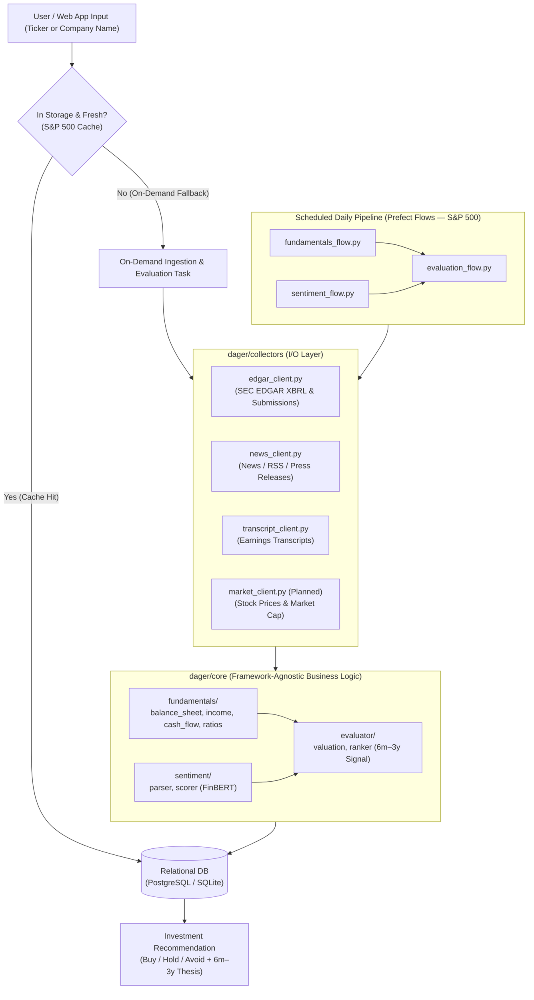

# DAGER — Long-Term Investment Research & Decision Engine

**DAGER** is a financial analysis web application and automated data pipeline that evaluates whether a public company is a strong long-term investment (**6-month to 3-year horizon**).

It combines fundamental analysis from **SEC EDGAR filings** (with a primary focus on balance sheet health, cash flows, and financial ratios), **NLP sentiment analysis** from financial news and earnings transcripts, and **market price action** to produce a transparent, multi-factor investment thesis.

---

## Core Objectives & Operating Modes

1. **Balance Sheet & Fundamental Health**: Extract XBRL financial facts (10-K / 10-Q) from SEC EDGAR to evaluate working capital, debt structure, liquidity, free cash flow runway, and return on invested capital (ROIC).
2. **News & Narrative Sentiment**: Scrape and score recent company news, RSS feeds, MD&A sections, and earnings call transcripts using financial NLP (`FinBERT`) to capture qualitative momentum and risk signals.
3. **Market Price & Valuation Context**: Pull historical and current stock prices to compare intrinsic value against market pricing, calculating margin of safety and 6-month to 3-year upside/downside potential.
4. **Dual Execution Model**:
   - **Pre-Computed S&P 500 Store (Daily Prefect Flows)**: A scheduled daily pipeline ingests filings, news, and prices for S&P 500 constituents and stores evaluations in the database for instant retrieval.
   - **On-Demand Ticker / Company Lookup (Cache-Miss Fallback)**: Users can search **any** ticker or company name. If the company is already in the database and fresh, DAGER serves the stored analysis immediately. If not stored, DAGER dynamically triggers an on-demand pipeline to pull SEC EDGAR balance sheets, recent news sentiment, and stock prices, then computes and caches the 6-month to 3-year investment prediction.

---

## System Architecture



---

## Repository Structure

```text
DAGER/
├── .env.example                     # Environment variable template (SEC_USER_AGENT, DB URI, API keys)
├── Dockerfile                       # Container definition for pipeline & web deployments
├── pyproject.toml                   # Dependencies, build config, and tool settings
├── README.md                        # Architecture & implementation plan (prompting reference)
│
├── dager/                           # Core application package
│   ├── config.py                    # App settings, logging, and environment parsing
│   │
│   ├── collectors/                  # Raw data extraction & API clients (I/O layer)
│   │   ├── edgar_client.py          # [Implemented] SEC EDGAR API wrapper (CIK lookup, XBRL facts, rate-limiting)
│   │   ├── news_client.py           # Financial news, RSS, and press-release scrapers
│   │   ├── transcript_client.py     # Earnings call audio/transcript scrapers
│   │   └── market_client.py         # (Planned) Historical & live stock price / market cap client
│   │
│   ├── schemas/                     # Data contracts & validation (Pydantic)
│   │   ├── filings.py               # Raw & normalized 10-K / 10-Q financial statement schemas
│   │   ├── sentiment.py             # Structured news article, summary, and sentiment score models
│   │   └── evaluation.py            # Final 6m–3y stock evaluation & recommendation output schema
│   │
│   ├── core/                        # Pure business logic (framework-agnostic)
│   │   ├── fundamentals/            # Financial statement processing
│   │   │   ├── balance_sheet.py     # Working capital, debt structure, liquidity & asset ratios
│   │   │   ├── income.py            # Margins, revenue growth, EBITDA calculations
│   │   │   ├── cash_flow.py         # Free cash flow (FCF), CapEx intensity, operational runway
│   │   │   └── ratios.py            # ROIC, Debt/Equity, Quick/Current ratio, DCF & price multiples
│   │   ├── sentiment/               # NLP and qualitative signal processing
│   │   │   ├── parser.py            # Text extraction, clean HTML, 10-K/10-Q MD&A parsing
│   │   │   └── scorer.py            # FinBERT sentiment weighting, recency decay & signal aggregation
│   │   └── evaluator/               # Decision engine (6-month to 3-year horizon)
│   │       ├── valuation.py         # Fair value estimation, price multiples & margin-of-safety checks
│   │       └── ranker.py            # Multi-factor composite scoring (Fundamentals + Sentiment + Price)
│   │
│   ├── storage/                     # Persistence layer
│   │   ├── db.py                    # Database connection pools (Engine / Session management)
│   │   ├── models.py                # Relational ORM models (Companies, Filings, Prices, Sentiment, Evaluations)
│   │   └── repositories.py          # CRUD & cache-lookup interfaces (CompanyRepo, FilingRepo, EvaluationRepo)
│   │
│   ├── pipeline/                    # Modular Prefect tasks
│   │   ├── tasks_fundamentals.py    # Tasks for SEC filing downloads, XBRL parsing, and ratio normalization
│   │   ├── tasks_sentiment.py       # Tasks for news retrieval, RSS parsing, and FinBERT scoring
│   │   └── tasks_evaluation.py      # Tasks for metric synthesis, composite scoring, and on-demand fallback
│   │
│   └── web/                         # (Planned) Web application & API layer (FastAPI + Frontend UI)
│       ├── api.py                   # Endpoints for ticker/name search, cache check, and on-demand trigger
│       └── ui/                      # Dashboard for balance sheet breakdown, sentiment trends, and verdict
│
├── flows/                           # Orchestrated Prefect workflows
│   ├── fundamentals_flow.py         # SEC EDGAR batch ingestion & ratio calculation flow
│   ├── sentiment_flow.py            # Periodic news/transcripts scraper & scoring flow
│   └── evaluation_flow.py           # Full S&P 500 daily scoring & on-demand single-ticker evaluation flow
│
└── tests/                           # Test suite (Pytest)
    ├── conftest.py                  # Fixtures (mock SEC companyfacts JSON, sample news feeds, test DB)
    ├── test_collectors.py           # Collector & API client unit tests
    ├── test_fundamentals.py         # Financial metric & balance sheet calculation accuracy tests
    └── test_flows.py                # Prefect flow & on-demand fallback integration tests
```

---

## Evaluation Methodology (6-Month to 3-Year Horizon)

DAGER produces an investment verdict (**Strong Buy / Buy / Hold / Avoid**) and a composite score (`0–100`) driven by three pillars:

### 1. Balance Sheet & Fundamental Strength (Primary Weight)
- **Liquidity & Solvency (`balance_sheet.py`)**: Current Ratio, Quick Ratio, Cash-to-Short-Term-Debt, Net Debt-to-EBITDA, Debt-to-Equity, and Book Value growth.
- **Cash Generation (`cash_flow.py`)**: Free Cash Flow (FCF) yield, FCF conversion rate, CapEx sustainability, and cash runway.
- **Profitability & Efficiency (`income.py`, `ratios.py`)**: Return on Invested Capital (ROIC), Gross/Operating/Net margin stability across multi-year 10-K/10-Q trends.

### 2. Valuation & Price Action (`valuation.py` + Market Prices)
- **Intrinsic vs. Market Price**: Compares normalized earnings and FCF against current market cap and historical price trends.
- **Margin of Safety**: Evaluates whether the current stock price offers sufficient upside over a 6-month to 3-year holding period relative to balance sheet risk.

### 3. News & Qualitative Sentiment (`parser.py`, `scorer.py`)
- **News & RSS Sentiment**: Aggregates recent company news headlines and articles, scored via `FinBERT` (positive / neutral / negative probability) with time-decay weighting.
- **Filing & Transcript Tone**: Parses 10-K/10-Q MD&A sections and earnings transcripts to detect management headwinds, guidance shifts, or risk-factor changes.

---

## Phased Implementation Roadmap 

### Phase 1: Foundation, Config & Schemas
- [x] **`pyproject.toml` & `.env.example`**: Define dependencies (`httpx`, `pydantic`, `pydantic-settings`, `sqlalchemy`, `prefect`, `yfinance` or price provider, `transformers`/`torch` for FinBERT, `fastapi`, `pytest`).
- [x] **`dager/config.py`**: Centralize settings (`SEC_USER_AGENT`, `DATABASE_URL`, news API keys, cache TTL for S&P 500 vs. on-demand lookups).
- [x] **`dager/schemas/`**: Define Pydantic models in `filings.py` (balance sheet, income, cash flow periods), `sentiment.py` (articles, sentiment scores), and `evaluation.py` (composite score, pillar breakdowns, 6m–3y recommendation).

### Phase 2: Collectors (SEC EDGAR, News, Prices)
- [x] **`dager/collectors/edgar_client.py`**: SEC EDGAR CIK lookup, rate-limited `companyfacts` and `submissions` fetcher.
- [x] **Company Name / Ticker Resolver**: Extend `edgar_client.py` to support fuzzy company title matching alongside ticker lookup (using SEC's `company_tickers.json` `title` field) and S&P 500 constituent list loading.
- [x] **`dager/collectors/market_client.py`**: Fetch historical stock prices (3–5 years), current price, market cap, and benchmark comparison.
- [x] **`dager/collectors/news_client.py` & `transcript_client.py`**: Pull recent company news via RSS/financial news APIs and earnings transcripts.

### Phase 3: Core Analysis Engine (Fundamentals, Sentiment, Evaluator)
- [x] **`dager/core/fundamentals/`**: Parse SEC XBRL `us-gaap` tags into standardized time series and compute balance sheet health (`balance_sheet.py`), cash flow metrics (`cash_flow.py`), profitability (`income.py`), and cross-statement ratios (`ratios.py`).
- [x] **`dager/core/sentiment/`**: Clean HTML/text (`parser.py`) and run FinBERT scoring with time-decay aggregation (`scorer.py`).
- [x] **`dager/core/evaluator/`**: Combine balance sheet health, price valuation (`valuation.py`), and sentiment into a 6-month to 3-year investment score and human-readable thesis (`ranker.py`).

### Phase 4: Persistence Layer (S&P 500 Store & Cache Lookup)
- [x] **`dager/storage/db.py` & `models.py`**: Configure SQLAlchemy engine/sessions and tables for `Company`, `FinancialStatement`, `StockPrice`, `SentimentRecord`, and `EvaluationResult`.
- [x] **`dager/storage/repositories.py`**: Implement `get_or_evaluate(query: str)` cache-check pattern—returning stored S&P 500 data when fresh, or flagging a cache miss for on-demand execution.

### Phase 5: Prefect Tasks & Daily / On-Demand Flows
- [ ] **`dager/pipeline/`**: Wrap collectors, core calculators, and repository writes into idempotent Prefect tasks (`tasks_fundamentals.py`, `tasks_sentiment.py`, `tasks_evaluation.py`).
- [ ] **`flows/`**:
  - **Daily S&P 500 Batch Flow**: Scheduled daily run of `fundamentals_flow.py`, `sentiment_flow.py`, and `evaluation_flow.py` across the S&P 500 universe.
  - **On-Demand Single-Company Flow**: Triggered when a user queries a non-cached or stale company ticker/name; pulls EDGAR balance sheets, news, and stock prices live, evaluates the 6m–3y outlook, persists results, and returns the report.

### Phase 6: Web Application & API
- [ ] **`dager/web/`**: Build the API and web dashboard where users can:
  - Browse ranked S&P 500 companies by 6m–3y investment score.
  - Search any company name or ticker (automatically triggering the on-demand flow if not already stored).
  - Inspect the balance sheet health breakdown, historical stock price vs. fair value, recent news sentiment, and the final investment recommendation.

---
